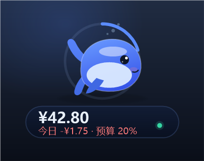
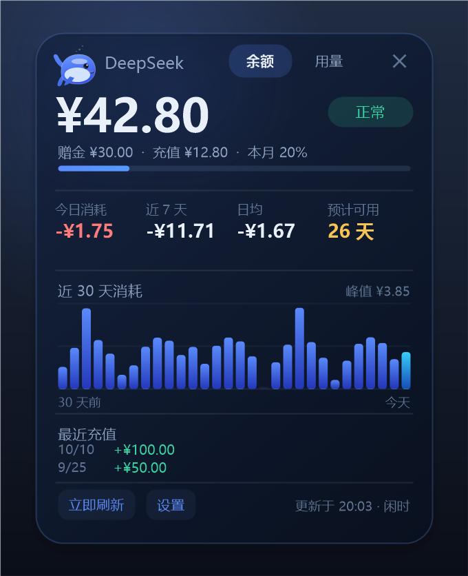
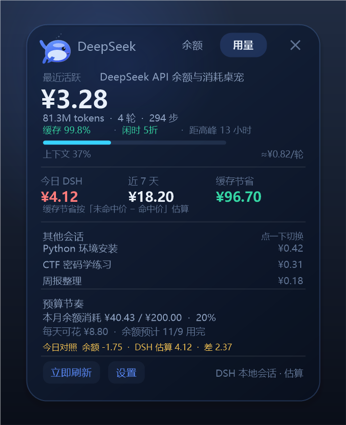
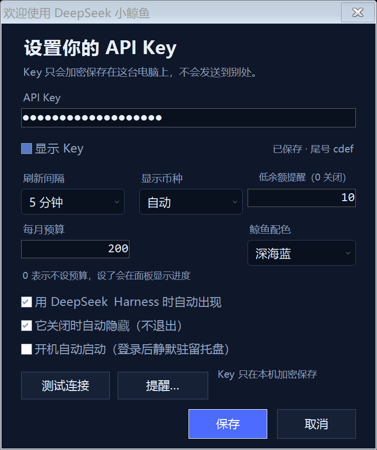
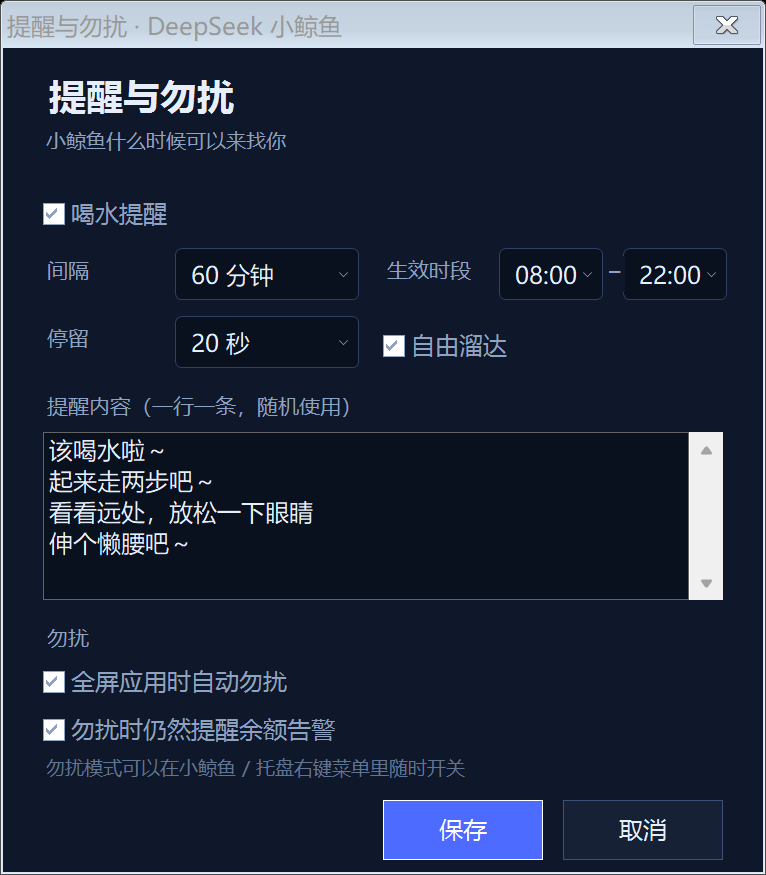
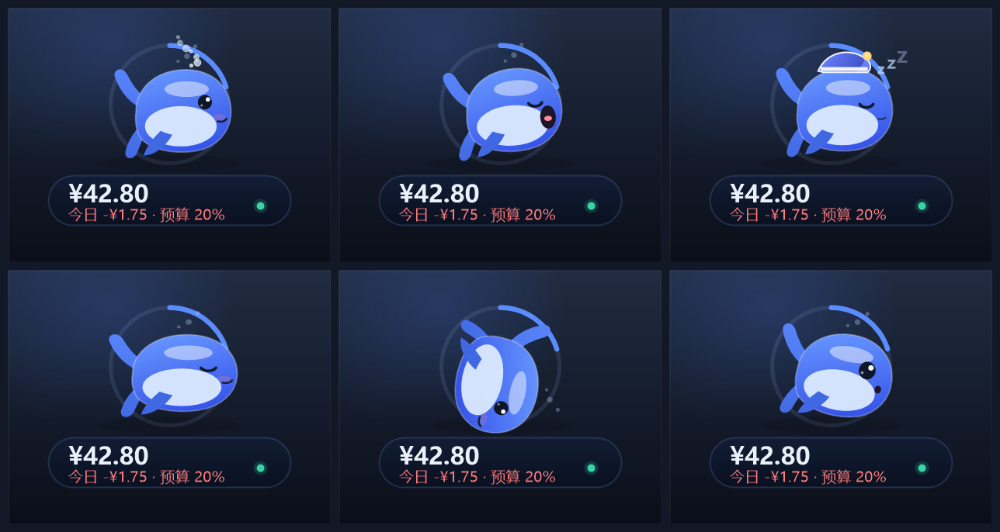

# DeepSeek 小鲸鱼

一个常驻桌面的 DeepSeek API 余额小挂件：透明悬浮的小鲸鱼 + 余额胶囊，点开是完整面板。
纯 C# / .NET Framework 4.8，编译成单个 exe，不依赖浏览器、Node 或安装包。







## 能看到什么

- **余额**：总余额、赠金、充值余额（CNY / USD，自动或手动选择）
- **消耗**：今日、近 7 天、日均、30 天柱状图
- **预计可用天数**：按最近 7 天日均消耗估算；没有消耗时显示「长期」，超过一年显示「1 年+」
- **月预算**（可选）：设置后鲸鱼外围有一圈预算进度环，胶囊里显示「预算 x%」
- **水炮模式**：右键 →「水炮模式」，点桌面图标，鲸鱼喷水柱把图标冲成水泡飞走，原地留一滩水盖住图标；文件不动，5 秒后水干图标回来
- **会话账本**：展开面板 →「用量」，看最近活跃 / 当前查看的会话花费、token、缓存命中、上下文压力、每轮成本、其他会话；点其他会话可以切换查看
- **缓存节省**：按官方「未命中价 − 命中价」估算缓存帮你省了多少钱
- **峰谷顾问**：显示现在闲时/高峰、距切换时间；高峰单价 2 倍
- **预算节奏**：本月余额消耗/预算、每天可花、余额预计用完日期
- **今日对照**：余额今日变化 vs DSH token 估算，差异大时标黄
- **点击互动**：单击鲸鱼会冒爱心，头顶弹出漫画对话气泡；双击鲸鱼或单击胶囊展开详情
- **漫画气泡**：点击回应、喝水提醒、充值到账、余额偏低都会用头顶的小气泡说话，不再挤在胶囊里
- **喝水提醒**：每 60 分钟（8:00–22:00）跑到屏幕中间，气泡随机说一句；点它就立刻回家，不点就在中间游走 20 秒再回去
- **提醒设置**：设置 →「提醒…」可以改间隔、生效时段、停留时长、自定义提醒内容
- **勿扰模式**：右键可选 30 分钟 / 1 小时 / 2 小时 / 到明早 / 一直勿扰；全屏应用时自动进入，退出全屏恢复
- **自由溜达**：空闲超过 90 秒时，偶尔在附近走两步再回来；右键可关
- **待机小动作**：每隔 7–14 秒随机吐泡泡、打哈欠、伸懒腰、转个圈或跳一下
- **拖拽反应**：被拎起来时会歪头、瞪大眼睛，松手后弹一下
- **夜间打盹**：23:00–07:00 自动戴上睡帽、闭眼冒 Zzz；点一下或告警会叫醒
- **三种配色**：深海蓝 / 樱花粉 / 薄荷绿，在设置里切换
- **迷你模式**：只留鲸鱼和余额数字，适合放在屏幕角落长期挂着
- **快捷键**：默认 Ctrl+Alt+D 显示/隐藏、Ctrl+Alt+M 迷你；被其他软件占用时会自动换键，右键菜单底部会显示实际键位
- **充值识别**：余额上涨会自动记为充值，不计入消耗，并用气泡提醒
- **异常消耗提醒**：当天消耗超过近 7 天日均 3 倍（且超过 ¥2）时提醒一次，6 小时冷却
- **小鲸鱼情绪**：正常 / 平静 / 余额偏低 / 欠费 / 离线，五种表情和配色
- **低余额提醒**：阈值可设（默认 ¥10），12 小时内最多提醒一次
- **托盘常驻**：显示 / 隐藏 / 立即刷新 / 锁定位置 / 开机自启 / 设置 / 退出；托盘图标右下角的小圆点会随状态变绿 / 蓝 / 黄 / 红
- **不透明卡片**：深色面板完全遮住背后的桌面内容，不会透出底层文字

## 下载

[GitHub Releases](https://github.com/Yinzhanqing/deepseek-whale/releases) 下载 `DeepSeekWhale-v1.1.1-win64.zip`，解压后双击 `安装.cmd`。

也可以从源码构建（见下方「从源码构建」）。

## 安装

1. 双击 `安装.cmd`
2. 程序会复制到 `%LOCALAPPDATA%\DeepSeekWhale`，创建桌面快捷方式，设置开机自启并启动
3. 第一次运行会自动打开设置，把 API Key 粘贴进去，点「测试连接」确认，再保存

卸载：双击 `卸载.cmd`。默认保留 `%APPDATA%\DeepSeekWhale` 里的 Key 和历史记录；要一并删除，运行
`powershell -ExecutionPolicy Bypass -File uninstall.ps1 -PurgeData`。

> 只支持 Windows 10 / 11，系统自带 .NET Framework 4.8 即可运行，不需要额外装运行时。

## 从源码构建

需要 Windows + .NET Framework 4.8（系统自带）：

```powershell
powershell -ExecutionPolicy Bypass -File build.ps1
```

产物是 `dist\DeepSeekWhale.exe`，单文件、无控制台。

## 怎么用

- **拖动**：按住小鲸鱼或胶囊拖动，位置会记住；鲸鱼会歪头瞪眼，松手弹一下；右键菜单可以「锁定位置」
- **单击鲸鱼**：摸摸它，冒爱心 + 头顶气泡台词
- **单击胶囊**：展开 / 收起详情面板
- **双击鲸鱼**：展开 / 收起详情面板（和单击胶囊一样）
- **看它发呆**：空闲时它会自己吐泡泡、打哈欠、伸懒腰、转圈、跳一下；晚上 23 点后戴睡帽打盹
- **让它跑腿**：右键 →「现在提醒喝水」会跑到屏幕中间提醒；「让它溜达一下」会在附近走两步
- **点它就回**：喝水提醒期间点它一下，它会说“好嘞，回去啦～”并立刻游回原位
- **行为开关**：右键 →「提醒与勿扰…」可以设置间隔、时段、停留时长、提醒内容，以及开关溜达
- **换配色**：设置 → 鲸鱼配色（深海蓝 / 樱花粉 / 薄荷绿）
- **迷你模式**：右键 →「迷你模式」，或按快捷键；只显示鲸鱼和余额数字，位置仍然可以拖
- **快捷键**：Ctrl+Alt+D 显示 / 隐藏，Ctrl+Alt+M 切换迷你；如果被别的软件占用，会自动换 Ctrl+Alt+Shift+D / Ctrl+Alt+Shift+M 或 F9，右键菜单底部能看到实际键位
- **面板里**：「立即刷新」重新拉取余额；「设置」改 Key、刷新间隔、阈值、预算、跟随 DSH 等
- **右键**：快捷菜单；「隐藏到托盘」只隐藏不退出，托盘图标双击可再显示
- **退出**：托盘右键 → 退出，或小鲸鱼右键 → 退出

## 水炮模式（冲走图标，但不动文件）

右键小鲸鱼 →「水炮模式」：

- 屏幕变暗，出现泡泡准星；点一下要冲的桌面图标（文件夹、文件、快捷方式都行），右键取消
- 鲸鱼转身、鼓气，喷出一道弧形水柱
- 目标被装进一个水泡，转着飞走
- 原位置留下一滩水，正好盖住图标；文件/文件夹本身没有移动、没有删除
- 约 5 秒后水洼干掉，图标重新露出来
- 纯视觉效果，不改文件；水泡里装的是目标那一小块屏幕的截图

## 提醒与勿扰

### 喝水提醒

- 默认每 60 分钟，只在 8:00–22:00 之间；从当前位置走到屏幕中间
- 到达后气泡随机说一句，然后就在中间区域游走（不是站着不动）
- 点它一下：立刻说“好嘞，回去啦～”，马上游回原位
- 不点：停留时间到了自己回家
- 设置 →「提醒…」可以改：间隔（30/45/60/90/120 分钟）、生效时段（0–23 点）、停留时长（10/20/30/60 秒）、自定义提醒内容（一行一条，随机用）

### 勿扰模式

- 右键 →「勿扰模式」：30 分钟 / 1 小时 / 2 小时 / 到明早 7 点 / 一直勿扰 / 关闭
- 开启后：不跑腿、不溜达、不弹气泡、不做待机动作；胶囊右侧变成紫色月亮，托盘图标变紫灰，提示剩余时间
- 全屏应用（游戏、视频）时自动进入勿扰，退出全屏自动恢复；可以在「提醒…」里关掉
- 勿扰时余额告警默认仍然提醒（托盘气泡），也可以关掉

## 用量账本（DSH 会话）

展开面板，顶部切到「用量」：

- 本次会话：花费、token、轮/步、缓存命中、上下文压力、每轮成本
- 今日 DSH / 近 7 天 / 缓存已省
- 最近会话排行
- 预算节奏 + 余额预计用完日期
- 对账：余额今日变化 vs DSH 估算
- 峰谷：闲时/高峰 + 距切换时间

数据来自本机 `%USERPROFILE%\.dsh\storages\session_projcache\sessions\*.json`，只读、只在本机显示，每 20 秒刷新；会话标题不会上传。就算没填 API Key，只要有 DSH 数据也能看。

计价按官方人民币价（元/百万 token）：

| 模型 | 缓存命中 | 未命中 | 输出 |
| --- | --- | --- | --- |
| flash 闲时 | 0.02 | 1 | 4 |
| flash 高峰 | 0.04 | 2 | 8 |
| pro 闲时 | 0.15 | 4.5 | 13.5 |
| pro 高峰 | 0.30 | 9 | 27 |

高峰 = 工作日 9–12、14–18；周末按闲时。节假日暂未单独处理。

所有金额都是**估算**，不是官方账单。对账差异大时，先看是否有数据延迟、赠送额度或其他 Key。

## 和 DeepSeek Harness 联动

默认开启「用 DeepSeek Harness 时自动出现」：

- 开机后小鲸鱼静默驻留托盘，不占桌面
- 打开 DeepSeek Harness（进程名包含 `DeepSeek Harness`）时，小鲸鱼自动出现
- 关闭 DeepSeek Harness 时自动隐藏（可在设置里关掉这个行为）
- 你也可以随时从托盘手动显示 / 完全退出；退出后本次登录不会再自动出现，直到下次开机或手动启动

## 消耗是怎么算的

DeepSeek 官方只提供「当前余额」接口（`GET https://api.deepseek.com/user/balance`），
**没有历史账单或 token 用量接口**。所以小鲸鱼的做法是：

1. 每隔 N 分钟（默认 5 分钟）采样一次余额，保存在本地
2. 相邻两次采样中，余额下降的部分累计为「消耗」
3. 余额上升的部分识别为「充值」，单独记录，不算消耗
4. 今日 / 7 天 / 30 天 / 日均都从这份本地历史里算

已知边界：

- 余额接口是**账号级**的，不是按 Key 拆分；同一个账号换 Key 也看不到分别花了多少
- 赠金过期会让余额下降，但目前无法和真实消耗区分，会被计入消耗（少见）
- 充值后如果立刻大量调用，充值金额按两次采样间的净增量记录，可能略小于实际充值
- 第一次运行只记录一个起点，要等下一次采样后才会出现「今日消耗」

## 数据与隐私

- API Key 用 Windows DPAPI（当前用户）加密后保存在 `%APPDATA%\DeepSeekWhale\config.json`，文件里没有明文
- 历史记录在同目录的 `history.json`，日志在 `whale.log`（不含 Key）
- 除了 `api.deepseek.com`，不向任何服务器发请求；没有统计、没有遥测
- 删除数据：退出后删掉 `%APPDATA%\DeepSeekWhale` 即可

## 常见问题

**打开很久还是「还没有数据」？**
点面板里的「立即刷新」；仍失败就打开设置点「测试连接」，看是 Key 无效、网络不通还是代理问题。

**余额没变化？**
余额只在有实际调用扣费后才变；而且官方接口有少量延迟，5 分钟刷新一次足够。

**小鲸鱼没跟 DSH 一起出现？**
确认设置里「用 DeepSeek Harness 时自动出现」是勾上的；如果刚开机 DSH 已经在运行，它会在启动后直接出现。
也可以在托盘右键「显示小鲸鱼」手动叫出来。

**会不会挡住全屏游戏 / 视频？**
它是置顶窗口，会显示在全屏窗口上方。不用时右键「隐藏到托盘」或直接退出即可。

**支持多账号吗？**
当前版本是单账号：一次只保存一个 Key，换账号会继续用同一份历史。多账号切换可以后续加。

## 开发

```powershell
# 编译（默认输出 dist\DeepSeekWhale.exe，无控制台）
powershell -ExecutionPolicy Bypass -File build.ps1

# 自检（配置加密、历史统计、JSON 解析、渲染冒烟）
dist\DeepSeekWhale.exe --selftest

# 生成界面预览图（render\*.png）
dist\DeepSeekWhale.exe --render render

# 用本地模拟接口联调，不碰真实 Key
node mock\server.js 18080
dist\DeepSeekWhale.exe --test --key sk-mock --api-base http://127.0.0.1:18080 --data-dir .\test\data --no-dsh --expanded
```

源码结构：

| 文件 | 作用 |
| --- | --- |
| `src/Renderer.cs` | 小鲸鱼、胶囊、面板、柱状图的全部 GDI+ 绘制与命中区域 |
| `src/PetWindow.cs` | 分层透明窗口、逐像素 alpha、点击穿透、拖拽、右键菜单 |
| `src/TrayApp.cs` | 定时采样、托盘、通知、DSH 进程跟随、设置应用 |
| `src/SettingsForm.cs` | 设置窗口（自绘深色下拉框） |
| `src/History.cs` | 本地采样历史与消耗统计 |
| `src/Api.cs` | 余额接口与错误文案 |
| `src/AppConfig.cs` | 配置序列化 + DPAPI |
| `src/DevRender.cs` | 离屏渲染预览 / 图标生成 |
| `mock/server.js` | 本地余额接口模拟（可切换 401 / 500 / 挂起） |

## 截图







## 卸载

`卸载.cmd`，或者手动删：

- `%LOCALAPPDATA%\DeepSeekWhale`
- 桌面快捷方式 `DeepSeek 小鲸鱼.lnk`
- 「启动」文件夹里的自启快捷方式 `DeepSeek 小鲸鱼.lnk`（`%APPDATA%\Microsoft\Windows\Start Menu\Programs\Startup`）
- 需要的话再删 `%APPDATA%\DeepSeekWhale`

## License

MIT © 2026 Yinzhanqing。更新日志见 [CHANGELOG.md](CHANGELOG.md)。

